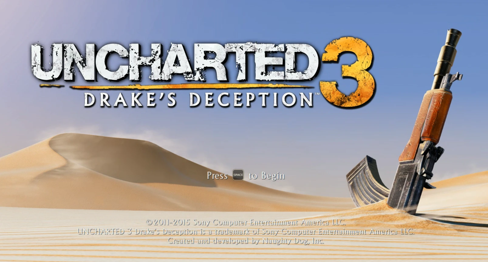
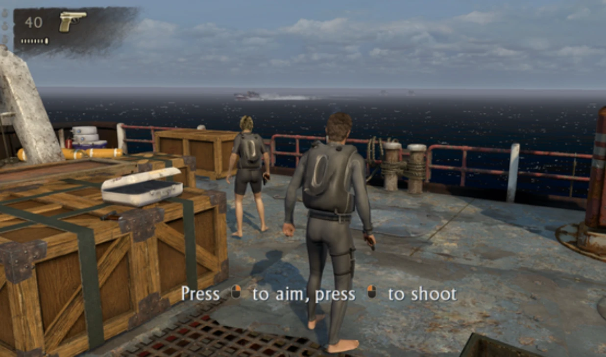
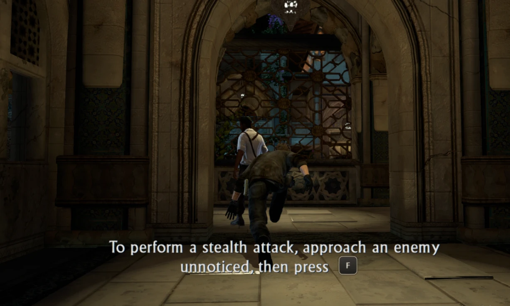
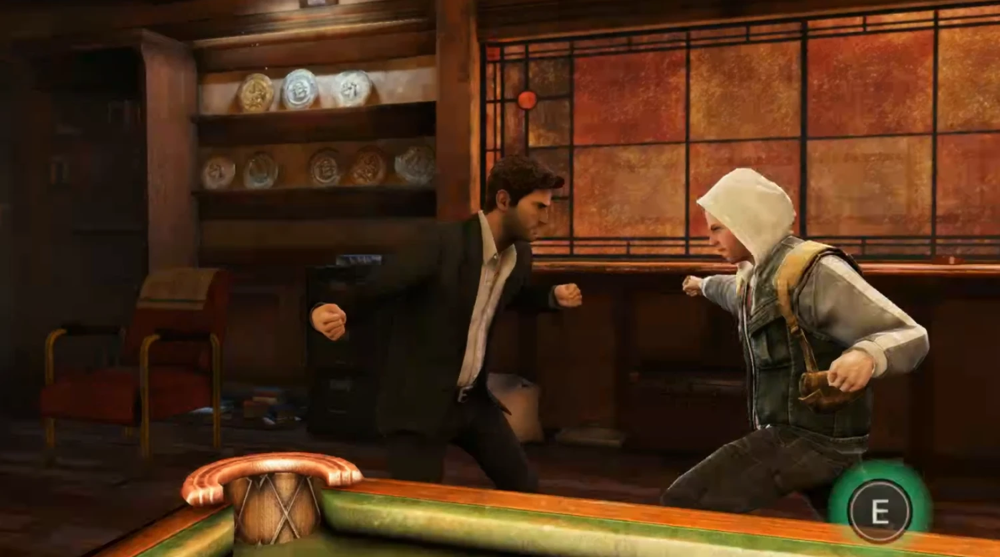

# Keyboard and mouse button prompts

The games only know PlayStation buttons. This port redraws their button pictures as the keys and
mouse buttons bound in `input.ini` while the keyboard or mouse was used last, and gives the game's
own pictures back after controller input. It also makes the bindings follow the keyboard layout.

| | |
|---|---|
|  |  |
| U3 title screen | U1 hint with the mouse buttons |
|  |  |
| U2 hint with the bound key | U2 hold prompt |
|  |  |
| U3 big prompt | U2 weapon pickup |

## What is covered

| Hash (XXH3 of mip 0) | Picture | Games | Seen in game |
|---|---|---|---|
| `97779d0906f16551` | icon sheet, 512x512 RGBA8 | U2 | yes |
| `ad5ada34fd34c76b` | icon sheet, 512x512 RGBA8 | U1 | yes |
| `8d03f2ff457f032d` | icon sheet colour, 512x512 RGBA8 (alpha 0) | U3 | yes |
| `ae0c06306763d424` | icon sheet mask, 512x512 RGBA8 (alpha in R, G, B) | U3 | yes |
| `5db884aa1bae54f9` | big round △, 256x256 BC1 | U2, U3 | yes |
| `7af1abf688d8c824` | big round ○, 256x256 BC1 | U2 | image only |
| `25d954ce23a8f5e2` | △ tapping "puck", 512x512 BC1 | U2 | yes |
| `c96e34fbb203279e` | △ hold puck, 512x512 BC1 | U2 | yes |
| `94d741f6b51815ee` | ○ tapping puck, 512x512 BC1 (sRGB) | U3 | image only |
| `93b46ba81469882c` | ○ hold puck, 512x512 BC1 (sRGB) | U3 | image only |
| `705083db743dd2f9` | weapon d-pad, 256x256 BC1 | U2 | image only |

The icon sheet has the same layout in all three games (`ps4_sheet` in `button_prompts.cpp`); it
holds the face buttons, shoulder buttons, sticks, d-pad variants, OPTIONS and the touchpad, which
menus and hints cut out. SHARE has no key and stays. Masks (BC4), glows, chevrons and weapon icons
are not buttons and are left alone.

Not collected yet: big ✕, □, L1 and R1 prompts, and pictures only some screens use. Adding one is
one table row (below).

## Switching

`runtime_pad.c` notes the last device used: a bound key, a mouse button, the wheel or mouse motion
of more than a few pixels means keyboard; a controller button, a trigger or a stick past half way
means controller. It calls
`bbgpu_prompts_controller()`, logged as `Button prompts: keyboard keys` or `Button prompts:
controller used, PlayStation buttons`.

- `ReplaceButtonPrompts()` (`texture_cache.cpp`), after the game uploads a texture: when its size
  and format can be a known picture, its guest data is hashed; a match records the range and, in
  keyboard mode, uploads the keyboard version over it.
- `UpdateButtonPrompts()` (from `Rasterizer::OnSubmit`): after a switch, the recorded ranges are
  invalidated, so the game's data is uploaded again and replaced or not.

The keyboard pictures are built once per picture and mip count, on the GPU thread, from the current
`input.ini` (the first key of each action).

## Keyboard layouts

The launcher saves the character printed on the key the player pressed. `runtime_pad.c` used to
look every name up as a scancode, the key's position on a US keyboard, so on AZERTY a binding to Z
landed on the key labelled W.

- A one-character binding (letter, digit, punctuation) that differs from the action's default is
  `BIND_LAYOUT`: an SDL keycode, turned into a scancode with `SDL_GetScancodeFromKey` at each read,
  so a layout switch applies at once.
- Defaults stay positions (`BIND_KEY`): WASD is ZQSD on AZERTY, with no setup.
- The prompts label default letters with `SDL_GetKeyName` of the key at that position, so an AZERTY
  player sees ZQSD on the movement cap.
- The log lists each layout key once the keyboard is up:
  `Runtime: key.ls_up Z: the key labelled so in this keyboard layout (US position W)`.

Still in the launcher: keys whose Tk keysym is not a plain letter or digit (AZERTY's top row
`& é " '`, Cyrillic letters) are not captured, so they can't be bound.

## Switches

| Variable | Effect |
|---|---|
| `BB_BUTTON_PROMPTS=0` | keep the PlayStation buttons |
| `BB_ICON_COLLECT=1` | save every picture sampled by a pass that draws to the display to `user/button_icons/<hash>_<w>x<h>_<format>.dds` (uncompressed slots at most 4 times: a sheet can be empty at first) |
| `BB_TEXTURE_DUMP=1` | F10 saves every texture of the next frame and the pass list to `user/texture_dump/<time>/` |

The two tools are for development and off by default.

## Adding a picture

1. Run the game with `BB_ICON_COLLECT=1` and get the prompt on screen.
2. Look at the new files in `user/button_icons/`: `python tools/dds_view.py <out dir> <files>`
   writes PNGs (BC1, BC4, RGBA8; no packages needed). Check the colour channels too: U3's sheet
   has its alpha in a separate texture.
3. Add a row:
   - an icon sheet with the usual layout: `sheets[]` (hash, size, name, `ps4_sheet`, layer);
   - a big prompt: `pictures[]` (hash, size, shape, action, glow colour = a corner pixel of the
     picture, name). Shapes: `RoundButton`, `Puck`, `PressedPuck`, `HudDPad`.
4. The log shows `Button prompts: <name> drawn as keyboard keys (<n> mip levels)` when it is used.

## Files

| File | What |
|---|---|
| `gpu/shadps4/video_core/texture_cache/button_prompts.{h,cpp}` | tables, drawing, BC1 encoder |
| `gpu/shadps4/video_core/texture_cache/texture_cache.{h,cpp}` | replacing after upload, switching |
| `gpu/shadps4/video_core/renderer_vulkan/vk_rasterizer.{h,cpp}` | switch check per submit |
| `gpu/shadps4/video_core/renderer_vulkan/vk_frame_capture.{h,cpp}` | collector and F10 dump |
| `gpu/bbgpu.h`, `gpu/shim/bbgpu.cpp`, `gpu/shim/window.cpp` | last device from the runtime |
| `src/runtime_pad.c` | last device, layout-aware bindings |
| `tools/dds_view.py` | collected pictures to PNG |
